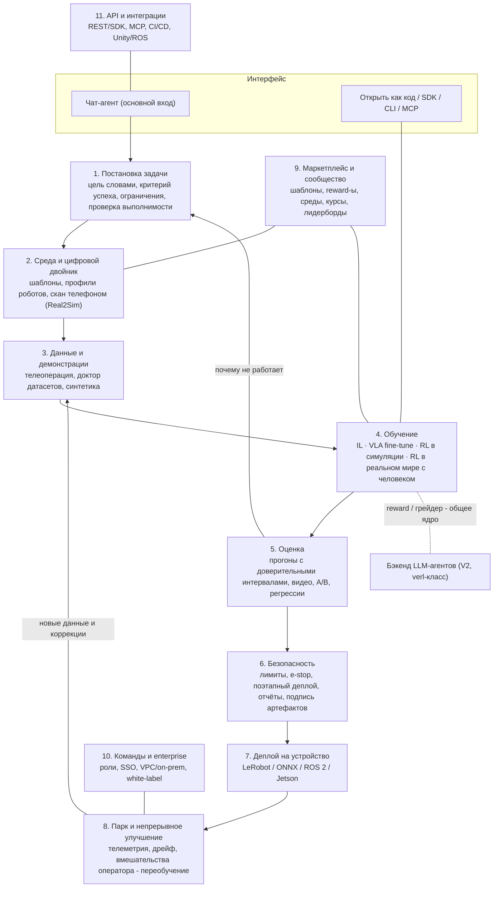

> Автор: агент «Директор по продукту» · Дата: 2026-10-27 · Прочитанные файлы research/: README.md, 01, 02, 03, 04, 05, 06, 07, 08 (полностью). Файлов 09-fact-check-gaps.md и 10-vision-strategy.md на момент записи в папке не было — фазы и позиционирование ниже предварительные и требуют сверки с 10 (см. §0).

# 11. Каталог функций и дополнительные идеи платформы

## 0. Как читать документ

**Это синтез, а не новый ресёрч.** Обоснования берутся из файлов 01–08 и указаны как `(см. 02 §6.1)` — файл и раздел. Новые утверждения подкреплены 8 веб-поисками, они помечены `[W1]…[W8]` (список в конце). Всё без ссылки — `(вывод)` или `(гипотеза)`.

**Обозначения.**
- Персоны (из 03 §6.1 и 08 §B): **Хоб** — хоббист/мейкер; **Студ** — студент/преподаватель; **Исс** — исследователь; **Инж** — инженер интегратора/завода; **Игр** — разработчик игр и программных агентов; **ML** — ML-инженер.
- Сложность: **S** — недели; **M** — 1–2 месяца команды из 2–3 человек; **L** — 3–6 месяцев; **XL** — полгода и больше или научный риск.
- Готовность технологии — оценка TRL из 02 §8 (1–3 идея, 4–5 лаборатория, 6–7 прототип, 8–9 продакшн). Для функций без технологического риска стоит «8+ (инж.)».
- MoSCoW: **M** — must, **S** — should, **C** — could, **W** — won’t в горизонте 2 лет.
- Фазы: **MVP** (0–6 мес.), **V1** (6–12), **V2** (12–24), **позже** (24+). Границы условные: в 10 может быть другая нарезка. Это согласуется с сеткой монетизации из 06 §D (фаза 1 — 0–12 мес., фаза 2 — 12–36).

**Противоречие в входных данных, которое надо решить в 10.** 04 (§F.3) рекомендует коммерческим плацдармом агентов для LLM/ПО (быстрый цикл, нет железа), а 08 (§D.1) — мейкеров и университеты вокруг LeRobot/SO-101 (плотная аудитория, но низкая платёжеспособность). Я строю каталог так, чтобы обе линии разделяли **одно ядро**: спецификация задачи → среда → грейдер/reward → job → оценка → версия (02 §9, 04 §F.1). MVP (§4) идёт по линии 08, потому что вопрос основателя о роботах; функции LLM-линии помечены фазой V2 и вынесены в идеи X8/X12.

---

## 1. Карта продукта по слоям



ASCII-вид сквозного пути пользователя (целевой «первая политика за 60 минут», 08 §D.2):

```
 цель словами ─► шаблон + sim ─► демо/или авто-reward ─► обучение ─► видео+оценка ─► safety-профиль ─► деплой ─► логи ─┐
       ▲                                                                   │                                         │
       └────────────── «почему не учится?» ◄───────────────────────────────┘◄────────── коррекции оператора ◄────────┘
```

Принцип из 03 §6.3: **no-code сверху, full-code снизу** — каждый слой имеет «развернуть в код».

---

## 2. Каталог функций (68)

Базовые тезисы, на которые опираются оценки: слой «движок + модель» бесплатен и стандартизируется (LeRobot поддерживает почти все открытые VLA, 02 §5; MuJoCo/MJWarp — Apache 2.0, 02 §2.3), поэтому ценность — в постановке цели, оценке, безопасности и воспроизводимости (01 §4.2, 02 «Выводы» п.1–4).

### 2.1 Слой 1 — Постановка задачи

| ID | Функция и что делает | Персона | Ценность | Сложн. | Готовность | MoSCoW | Фаза | Обоснование |
|---|---|---|---|---|---|---|---|---|
| T1 | **Чат-агент как основной интерфейс**: ведёт от цели до деплоя, сам создаёт конфиги, запускает job, пояснения по-человечески | все | Снимает «пустой экран»; парадигма 2026 (Lovable/Replit/Cursor) | L | 6–7 (LLM) | M | MVP (узкий сценарий) | 03 §2.3, §6.3 |
| T2 | **Цель на естественном языке → спецификация задачи**: цель, критерий успеха, ограничения, горизонт; агент показывает «как я понял», пользователь подтверждает | Хоб, Студ, Инж | Не-эксперты предпочитают цели, а не reward | M | 6–7 | M | MVP | 02 §8 шаг 1; 03 §4.1 (RLC 2025) |
| T3 | **Шаблоны задач** (ходьба Go2/G1, pick-and-place SO-101, reach, balance, навигация) с параметрами | Хоб, Студ | TTFW ≤10 мин; надёжнее генерации сред | M | 7–8 (локомоция), 5–6 (манипуляция) | M | MVP (3–5 шаблонов), V1 (15+) | 02 §6.2, §7; 03 §6.2 |
| T4 | **Критерий успеха «покажи»**: клик успех/провал на видео, пример видео → обучаемый классификатор успеха и VLM-судья | Хоб, Инж | Заменяет написание reward; основа HIL-RL | M | 5–6 (RoboReward-класс) | S | V1 | 02 §6.1, §3 (HIL-SERL) |
| T5 | **Ограничения словами** («не выходи за стол, ≤0.3 м/с, не касайся человека») → автоматически в safety-профиль | Инж, Хоб | Мост между постановкой и безопасностью | M | 6 | S | V1 | 02 §6.1 (DrEureka); 07 §A.3 |
| T6 | **Проверка выполнимости («матрица что получится/нет»)**: до запуска агент говорит, реалистична ли задача на этом роботе, и предлагает упрощение | все | Честность вместо обещания универсальности; снижает отток | S | 8+ (правила) + 6 (LLM) | M | MVP | 02 §«Выводы» п.1; 03 §6.3 |

### 2.2 Слой 2 — Среда и цифровой двойник

| ID | Функция и что делает | Персона | Ценность | Сложн. | Готовность | MoSCoW | Фаза | Обоснование |
|---|---|---|---|---|---|---|---|---|
| E1 | **Симуляция в браузере** (стрим MJX/MJWarp, живые ролики) | все | Мгновенный первый результат без GPU у пользователя | L | 7–8 | M | MVP | 02 §2; 03 §6.2 |
| E2 | **Библиотека профилей роботов** (SO-101, Reachy Mini, Microduck, Go2/G1 EDU; кинематика, камеры, лимиты) | Хоб, Студ, Инж | Один слой на семейство железа; основа safety-лимитов | M (на каждого) | 8 | M | MVP (SO-101 + 1), V1 (6–8) | 02 §7 «кросс-эмбодимент»; 08 §D.1 |
| E3 | **Импорт своего робота** (URDF/MJCF) + автопрофиль лимитов | Исс, Инж | Escape hatch; не привязывает к списку | M | 8 | S | V1 | 03 §5; 07 §E (фрагментация железа) |
| E4 | **Скан сцены телефоном → симуляция** (3DGS/NuRec, коллизионная геометрия) | Инж, Студ | Цифровой двойник рабочего места без CAD | XL | 5–6 | C | V2 | 02 §6.3; [W6] |
| E5 | **Автоматическая domain randomization** + рекомендация диапазонов | Исс, Инж | Снижает sim2real-риск без знаний | M | 7 | S | V1 | 02 §6.1 (DrEureka); 07 §D.1 |
| E6 | **Текст → сцена/задача** (RoboGen-подход, Objaverse-ассеты) | Хоб, Игр | Быстрый вариативный набор задач для обучения | XL | 4–5 | C | позже | 02 §6.2 |
| E7 | **Опциональный бэкенд Isaac Lab** (для тех, кому нужен реализм/RTX-рендер) | Исс, Инж | Подключает экосистему NVIDIA без зависимости от неё | L | 8 | C | V2 | 02 §2.3; 05 §6 (юр. проверка) |

### 2.3 Слой 3 — Данные и демонстрации

| ID | Функция и что делает | Персона | Ценность | Сложн. | Готовность | MoSCoW | Фаза | Обоснование |
|---|---|---|---|---|---|---|---|---|
| D1 | **Запись демонстраций** лидер-фолловером/геймпадом/телефоном через LeRobot, загрузка в LeRobotDataset | Хоб, Студ, Исс | Основной вход для манипуляции; железо уже у сообщества | M | 8 | M | MVP | 02 §4; 08 §A.2 |
| D2 | **Телеоперация из браузера/VR** (WebRTC-видео, удалённый оператор, Quest) | Инж, Хоб | Позволяет работать с роботом удалённо; база для X2 | L | 8 (браузер), 6 (VR) | S (браузер) / C (VR) | V1 / V2 | 02 §8 шаг 4; 03 §4.1 (MR нишево) |
| D3 | **Доктор датасетов**: проверка синхронизации камер, пустых/дублей, длины, разнообразия, выбросов, «43% датасетов — 1–5 эпизодов»; отчёт и автоисправления | Хоб, Исс, Инж | Измеримая боль; главный wedge | M | 8 (эвристики) + 6 (VLM) | M | MVP | 08 §A.2, §D.2; 03 §4.1 |
| D4 | **Тренер демонстраций**: оценка качества эпизода «на лету», подсказки оператору | Хоб, Студ | Не-эксперты дают плохие демо | M | 7 | S | V1 | 03 §4.1 (HCI) |
| D5 | **Аугментация и синтетика** (Cosmos Transfer, sim-to-real видео, вариации света) | Исс, ML | Сокращает число реальных демо | L | 5–6 | C | V2 | 02 §6.4; [W7]; 05 §4.1 |
| D6 | **Генерация демонстраций в симуляции** (скрипты, mimic-подход) | Исс, Студ | Дешёвый старт без железа | L | 6–7 | C | V2 | 02 §2.1 (isaaclab_mimic) |
| D7 | **Версионирование датасетов + импорт/экспорт с HF Hub** | Исс, ML | Воспроизводимость; интеграция «рядом, а не против» | S | 8 | M | MVP | 08 §D.1 п.2; 08 «Выводы» п.1 |

### 2.4 Слой 4 — Обучение

| ID | Функция и что делает | Персона | Ценность | Сложн. | Готовность | MoSCoW | Фаза | Обоснование |
|---|---|---|---|---|---|---|---|---|
| R1 | **Один клик: imitation learning** (ACT/Diffusion Policy), авто-конфиг, spot-GPU | Хоб, Студ | Самый дешёвый рабочий путь ($1–10 за задачу) | M | 7–8 | M | MVP | 02 §4; 05 §2.2 |
| R2 | **Один клик: fine-tune VLA** (SmolVLA → π0.5 → GR00T) с выбором модели по лицензии и бюджету | Хоб, Инж, Исс | Выбор модели — параметр, а не стратегия | L | 7–8 | M (SmolVLA) / S (остальные) | MVP / V1 | 02 §5; 05 §2.2, §6 |
| R3 | **RL в симуляции по шаблонам** (PPO, MJX/RSL-RL; локомоция, reach) | Хоб, Студ, Исс | Зрелая технология; минуты на GPU | M | 7–8 | M | MVP | 02 §3, §2.2 |
| R4 | **Авто-reward из цели** (Eureka-подход на MJX/Isaac Lab, итерации с отбором) | Хоб, Студ, Игр | Убирает главный барьер | L | 5–6 | M | MVP (локомоция/reach), V1 (шире) | 02 §6.1; 03 §4.1 |
| R5 | **Проверка reward hacking**: VLM-судья смотрит ролики, эвристики (дрожь, застревание, эксплойт сенсора), блок запуска на железо до подтверждения | все | Центральная продуктовая проблема | L | 5–6 | M | MVP (базовая), V1 (VLM) | 07 §D.2; 02 §7; [W8] |
| R6 | **Обучение по предпочтениям**: пары роликов «лучше/хуже» → reward-модель | Хоб, Студ, Инж | Простая обратная связь вместо кода | L | 5–6 | S | V1 | 03 §4.1 (rating-based RL); 07 «Выводы» п.6 |
| R7 | **RL в реальном мире с человеком в контуре** (HIL-SERL-класс: демо + коррекции + классификатор успеха) | Инж, Исс | Единственный путь к надёжной манипуляции; премиум | XL | 5–6 | S | V1 (пилот), V2 | 02 §3, §7; 01 §4.1 п.1 |
| R8 | **Advantage-conditioned дообучение из логов и коррекций** (Recap-lite на открытых VLA) | Инж, Исс | Основа «непрерывного улучшения» | XL | 4–5 | C | V2 | 02 §3.1, §«Выводы» п.7 |
| R9 | **Доктор обучения + AutoRL**: «почему не учится» (3 гипотезы), авто-подбор гиперпараметров, выбор алгоритма с единым набором настроек (TD-MPC2/Dreamer-класс) | Хоб, Студ | Диагностика — вторая главная UX-боль | L | 5–6 | S | V1 | 03 §«Выводы» п.3, §6.3; 02 §6.5 |
| R10 | **Бюджет и спот**: оценка стоимости до запуска, потолок, чекпоинты, автоперезапуск | все | Защита маржи и пользователя от «спирали затрат» | M | 8+ | M | MVP | 06 §C.2, §D.5; 05 §1.3 |
| R11 | **Экспертный режим**: свой reward-код, свой алгоритм, ноутбуки, экспорт проекта в Python | Исс, ML | Escape hatch; удержание продвинутых | M | 8+ | S | V1 | 03 §5 (потолок возможностей) |

### 2.5 Слой 5 — Оценка

| ID | Функция и что делает | Персона | Ценность | Сложн. | Готовность | MoSCoW | Фаза | Обоснование |
|---|---|---|---|---|---|---|---|---|
| V1 | **Серия прогонов с доверительными интервалами** (sim и реальный робот; N, % успеха, ошибки по причинам) | все | Единственный честный ответ на «стало ли лучше» | M | 7 (sim), 5–6 (real) | M | MVP | 02 §7 «Evaluation», «Выводы» п.4 |
| V2 | **Галерея видео-роллаутов** с метками успех/провал и поиском | все | Видео понятнее кривых (гипотеза) | S | 8+ | M | MVP | 03 §4.2 |
| V3 | **A/B-сравнение политик** (слепое, парное, с комментарием) | Инж, Исс | Основа выбора версии и preference-данных | M | 7 | M | V1 (минимум в MVP: сравнение двух) | [W2]; 03 §6.2 |
| V4 | **CI/CD и регрессионные тесты для политик**: набор сценариев, запуск при каждой новой версии, блок релиза при падении | Инж, ML | Превращает платформу в процесс; удержание команд | L | 6–7 | S | V1 | 07 §A.3; 02 §8 шаг 8 |
| V5 | **Real-to-sim прокси-оценка** (дешёвая оценка в 3DGS-симуляции до реального прогона) | Исс, Инж | Меньше реальных прогонов | XL | 4–5 | C | V2 | 02 §6.3, §7 |
| V6 | **Отчёт об области применимости и стресс-тестах** (свет, объект, возмущения; где политика ломается) | Инж, Исс | Против «обучил в sim — работает всегда» | M | 6 | S | V1 | 02 §7 «Обобщение»; 07 §D.1 |

### 2.6 Слой 6 — Безопасность

| ID | Функция и что делает | Персона | Ценность | Сложн. | Готовность | MoSCoW | Фаза | Обоснование |
|---|---|---|---|---|---|---|---|---|
| S1 | **Safety layer по умолчанию**: лимиты скорости/силы/момента/зоны из профиля робота, фильтр действий политики | все | «Политика предлагает — слой решает» | M | 8 (лимиты) | M | MVP | 07 §A.2–A.3 |
| S2 | **E-stop, watchdog, heartbeat** (программный + поддержка внешнего аппаратного) | Инж, Хоб | Минимум допустимой безопасности железа | M | 8 | M | MVP | 07 §A.3 |
| S3 | **Поэтапный деплой**: sim → пониженные лимиты в тестовой зоне → полные; dry-run | все | Блокирует небезопасное исследование на железе | M | 7 | M | MVP | 07 §A.3, §D.3 |
| S4 | **Отчёт для сертификации**: журнал валидации, версии, покрытие сценариев, SW-манифест; шаблон для интегратора | Инж | Главный B2B-аргумент; требуется клиентам по PLD/Machinery | L | 7 | S | V2 | 07 §B.2–B.3, «Выводы» п.2–3 |
| S5 | **Подпись артефактов + безопасные форматы** (safetensors/ONNX, без pickle), сканирование в песочнице | все | Нужна до любого обмена политиками | M | 8 | M | MVP (форматы) | 07 §D.4 |
| S6 | **Журнал аудита / «чёрный ящик»**: кто, какую версию, с какими лимитами; повтор инцидента | Инж, Enterprise | Доказательная база при иске; требуется страховщиками | M | 8 | S | V1 | 07 §B.6; [W4] |

### 2.7 Слой 7 — Деплой на устройство

| ID | Функция и что делает | Персона | Ценность | Сложн. | Готовность | MoSCoW | Фаза | Обоснование |
|---|---|---|---|---|---|---|---|---|
| P1 | **Экспорт в LeRobot/ONNX** (политика, конфиг, нормализация, профиль) | Хоб, Исс, ML | Ключ к отсутствию lock-in | S | 8 | M | MVP | 02 §«Выводы» п.1; 03 §5 |
| P2 | **Экспорт ROS 2-нода** | Инж, Исс | ROS 2 — обязательный экспорт-таргет (91% загрузок ROS) | M | 8 | S | V1 | 08 §A.3 |
| P3 | **Упаковка под Jetson/CPU**: квантование, TensorRT, проверка частоты | Инж, Хоб | Автономность; цены Jetson выросли | L | 6–7 | S | V1 | 02 §5 (GR00T ~28 Гц на Thor); 05 §2.2 |
| P4 | **Локальный агент развёртывания** (десктоп-приложение, подключается к роботу, запускает политику с safety layer) | Хоб, Студ | Закрывает «облако не должно быть точкой отказа» | M | 8 | M | MVP | 07 §F (Anki, Moxie) |
| P5 | **Canary-деплой и откат** (иммутабельные версии, сравнение метрик) | Инж | Основа fleet-цикла | M | 7 | S | V1 | 07 §A.3 |

### 2.8 Слой 8 — Парк и непрерывное улучшение

| ID | Функция и что делает | Персона | Ценность | Сложн. | Готовность | MoSCoW | Фаза | Обоснование |
|---|---|---|---|---|---|---|---|---|
| F1 | **Мониторинг парка**: метрики успеха, аномалии, статус, видео сбоев | Инж | Эксплуатация — то, за что платят предприятия | L | 8 (телеметрия), 6 (качество) | S | V1 (1–5 роботов), V2 (парк) | 07 §D.3; 03 §3 (Formant) |
| F2 | **Детектор дрейфа и автооткат** по порогам | Инж | Износ, освещение, прошивка | M | 6–7 | S | V2 | 07 §D.3 |
| F3 | **Сбор вмешательств оператора** → очередь на переобучение (ручной запуск в V1, авто — в V2) | Инж, Исс | Основа flywheel «данные о неудачах» | L | 4–6 | S | V1 (сбор), V2 (авто) | 02 §8 шаг 10; 06 §E |
| F4 | **OTA-обновления и политика патчей** | Инж | PLD: отсутствие обновлений безопасности может считаться дефектом | M | 8 | S | V2 | 07 §B.3, §D.3 |

### 2.9 Слой 9 — Маркетплейс и сообщество

| ID | Функция и что делает | Персона | Ценность | Сложн. | Готовность | MoSCoW | Фаза | Обоснование |
|---|---|---|---|---|---|---|---|---|
| M1 | **Публичные проекты, форки, шаринг по ссылке** (видео + шаблон + конфиг) | Хоб, Студ | Органический рост (модель Roboflow Universe/HF) | M | 8+ | M | MVP (ссылка), V1 (форки) | 08 §C, §E |
| M2 | **Маркетплейс сред и сцен** | Хоб, Студ, Игр | Проще переносится, чем политики | L | 8+ | C | V2 | 06 §C.3; 04 §A.3 |
| M3 | **Хаб reward-/грейдер-шаблонов** с рейтингом и тестом на «обман» | все | Дефицитный ресурс — верификатор | M | 7 | S | V1 | 04 «Выводы» п.2; 07 §D.2 |
| M4 | **Маркетплейс навыков/политик** (на семейство железа) | Хоб, Инж | Каталог готовых навыков | XL | 5–6 | C | V2 (SO-101), позже | 06 §C.3; 07 §D.4; 08 §E |
| M5 | **Лидерборды и открытая арена** (см. X3) | Студ, Исс | Видимость, соревнования | L | 6 | C | V2 | [W2]; 08 §C (DeepRacer) |
| M6 | **Образовательные курсы и дашборд преподавателя** (класс, проекты, лимиты, выдача кредитов) | Студ | Дешёвый канал и малый стабильный поток | M | 8+ | S | V1 | 06 §C.8; 08 §B.1 |

### 2.10 Слой 10 — Команды и enterprise

| ID | Функция и что делает | Персона | Ценность | Сложн. | Готовность | MoSCoW | Фаза | Обоснование |
|---|---|---|---|---|---|---|---|---|
| B1 | **Воркспейсы, роли и права доступа** (владелец, оператор, ревьюер, наблюдатель) | Инж, Студ | База тарифа Team; ревьюер деплоя — часть safety | M | 8+ | S | V1 | 06 §D.2 |
| B2 | **SSO, аудит-лог, SCIM** | Инж | Требование enterprise | M | 8+ | S | V2 | 06 §C.4 |
| B3 | **VPC / on-prem** (все слои, в т.ч. без внешней сети) | Инж | Заводы и приватность; $30–150 тыс./год | XL | 7 | S | V2 | 06 §C.4; 07 §D.5 |
| B4 | **Управление данными: регион хранения, удаление, размытие лиц, edge-обработка** | Инж | GDPR, локализация | M | 8 | S | V1 | 07 §D.5 |
| B5 | **White-label** для интеграторов и OEM | Инж | Канал продаж | L | 8 | C | V2 | 08 §B.1; X10 |

### 2.11 Слой 11 — API и интеграции

| ID | Функция и что делает | Персона | Ценность | Сложн. | Готовность | MoSCoW | Фаза | Обоснование |
|---|---|---|---|---|---|---|---|---|
| A1 | **Python SDK + CLI + REST** | ML, Исс | Удержание продвинутых; основа остальных API | M | 8+ | M | MVP | 03 «Выводы» п.6 |
| A2 | **MCP-сервер платформы** (X1) | все, ML | Канал: Claude/ChatGPT как интерфейс | M | 7 | S | V1 | [W1] |
| A3 | **«Открыть как код»** — экспорт проекта целиком (reward, конфиг, скрипты) | Исс, ML | Принцип «full-code снизу» | S | 8+ | M | MVP | 03 §6.3 |
| A4 | **Интеграции CI** (GitHub Actions, webhooks) | ML, Инж | Нужны для V4 | S | 8+ | C | V1 | 07 §A.3 |
| A5 | **Плагин Unity/Unreal и бэкенд LLM-агентов (verl-класс)** | Игр, ML | Второй домен на общем ядре | XL | 7 (verl), 8 (Unity) | C | V2 | 04 §A, §F; 02 §9 |

**Итого 68 функций**: Must — 27, Should — 28, Could — 13 (для функций с двумя метками считана первая).

---

## 3. Дополнительные идеи (16), которые основатель, вероятно, не рассматривал

Для каждой: что это, **почему может сработать**, **почему может не сработать**, и первый шаг. Все оценки результатов — `(гипотеза)`, пока не проверены интервью.

### X1. Платформа как MCP-сервер: «Claude, обучи моего робота подносить чашку»
- **Суть.** Платформа выставляет инструменты (создать задачу, запустить обучение, посмотреть ролики, оценить, задеплоить с подтверждением) для любого MCP-клиента.
- **Почему сработает.** Уже существует MCP-сервер для SO-ARM100/LeKiwi, работающий с Claude Desktop, Cursor и Windsurf; автор сообщает, что Claude справляется лучше GPT/Gemini [W1]. Значит, мейкеры уже общаются с роботами через LLM-клиенты. Интерфейс «чат» (03 §2.3) приходит бесплатно, и платформа получает канал дистрибуции там, где пользователь уже сидит.
- **Почему может не сработать.** Тот же автор предупреждает о стоимости токенов из-за картинок [W1]; MCP-клиенты контролируют UX и могут «обернуть» нас в commodity. Безопасность: LLM не должна сама снимать лимиты — деструктивные действия только с подтверждением человека (07 §A.2).
- **Первый шаг.** A2 в V1, с набором инструментов только на чтение + запуск sim-обучения.

### X2. Краудсорсинговый маркетплейс телеоператоров и демонстраций
- **Суть.** Пользователь без времени/навыков заказывает 50 демонстраций; удалённые операторы управляют его роботом (D2) или записывают в симуляции и получают оплату.
- **Почему сработает.** Рынок труда уже есть: US-телеоперация предлагается за $25–65/ч, сбор бытовых видео — $13–25/ч, за рубежом $3–15/ч [W3]; сырой час у вендоров $28–60 (05 §4.1, 06 §C.6). Для хоббиста 50 демо — 2–5 часов собственного времени (05 §4.1) — платить за это логично.
- **Почему может не сработать.** Данные чужого железа в чужих сценах имеют низкое качество, цена сырого часа падает (≈$340 → ≈$120–136/ч за два года, 06 §C.6); задержки связи; юридически — трудовые отношения и приватность (камеры дома, 07 §D.5); chicken-and-egg двух сторон.
- **Первый шаг.** Не маркетплейс, а список проверенных операторов в рамках пилотов с интеграторами (V2); сначала только sim-демо.

### X3. «RL Arena» — открытый лидерборд навыков на реальных роботах
- **Суть.** Парные слепые сравнения политик на реальных роботах участников, ранжирование по принципу RoboArena.
- **Почему сработает.** Академическая версия показала >600 парных оценок на семи политиках и более точное ранжирование, чем централизованные соревнования; инфраструктура открыта сообществу [W2]. Стандартного бенчмарка оценки нет (02 §7), а наш модуль V3 уже даёт нужную механику. Бенчмарк — узнаваемость и moat в «оценке».
- **Почему может не сработать.** DeepRacer собрал 560 тыс. участников и всё равно закрыт: участие ≠ платная ценность (08 §C, §E). Нужна разнородность железа, иначе рейтинги несопоставимы (02 §7 «кросс-эмбодимент»).
- **Первый шаг.** Арена для одного железа (SO-101) со ссылкой на LeRobot-хакатоны (08 §A.2); бюджет — только за счёт партнёров.

### X4. Лиги и соревнования с уроком DeepRacer
- **Суть.** Сезонные лиги для школ/клубов: задача месяца, симуляция + физический этап (X9).
- **Почему сработает.** FIRST — ~3 724 команды (2026), хакатоны LeRobot — 100+ площадок (08 §B.2, §A.2); игровая механика даёт контент и вирусность.
- **Почему может не сработать.** AWS закрыл лигу, потому что программа жила за счёт облака вендора без автономной юнит-экономики (08 «Выводы» п.8; 03 §2.2).
- **Правило.** Лига — маркетинг, оплачиваемый из бюджета маркетинга (08 §D.7), а не продукт; формат — мини-трек «RL fine-tuning» на чужих хакатонах (08 §D.3).

### X5. Страхование и сертификация политик вместе с партнёрами
- **Суть.** Отчёт S4 + журнал S6 дают андеррайтеру данные: версия, покрытие тестов, лимиты, инциденты. Партнёр-страховщик продаёт полис «политика на нашем safety layer».
- **Почему сработает.** Страховые продукты для роботов уже выпускаются: CPIC и другие китайские страховщики продают полисы для гуманоидов (ущерб, ответственность перед третьими лицами, посуточно/помесячно); Lloyd’s Lab поддержал разработку андеррайтинга для автономных роботов и подчёркивает данные в реальном времени и актуарные модели [W4]. Андеррайтерам нужен именно «процесс валидации» (07 §B.6). Венчурный тезис: стартап с глубоким знанием железа и ПО может прогнозировать поломки лучше страховщика [W4] (мнение инвестора).
- **Почему может не сработать.** Истории убытков нет, ответственность размыта между пользователем, производителем и платформой (07 §B.6, [W4]); мы не страховая компания. Любая формулировка «безопасно» создаёт нам ответственность (07 §A.3).
- **Первый шаг.** Включить пункт в E&O-страхование самой платформы и попросить брокера об условиях (07 «Выводы» п.2); продавать не полис, а «доказательный пакет».

### X6. «Навык как подписка» для владельцев домашних роботов
- **Суть.** Пользователь домашнего/офисного робота подписывается на навыки (разгрузить посудомойку, полить растения), обученные и проверенные на его модели.
- **Почему сработает.** Магазины навыков появляются: Unitree анонсировала магазин приложений движений для гуманоидов (источник за пейволлом, цены/подписки не найдены) [W5]; у Robosen, Synthiam, Robotiq — каталоги навыков [W5]. 1X NEO продаётся за $20 000 или $499/мес (05 §3) — подписочный клиент уже платит.
- **Почему может не сработать.** Данные роботов не взаимозаменяемы (08 §E), ответственность за домашнюю безопасность (07 §B.6), риск «кирпича» при закрытии (Anki, Moxie; 07 §F). Домашние гуманоиды массово ещё не поставляются.
- **Первый шаг.** Только после M4 для одного семейства железа; режим локальной работы обязателен.

### X7. Цифровые двойники для заводов — «сканируй, обучай, проверяй»
- **Суть.** E4 + V5 как корпоративный продукт: съёмка линии телефоном, сборка симуляции с коллизиями, обучение и проверка до остановки производства.
- **Почему сработает.** Пайплайн существует у NVIDIA (NuRec: фото со смартфона → OpenUSD → Isaac Sim) и в академических работах (EmbodiedSplat на iPhone-сканах: +20% и +40% к успеху против zero-shot в навигации) [W6]. Интеграция стоит в 4–5 раз дороже робота (08 §B.2) — любое сокращение монтажа продаётся.
- **Почему может не сработать.** Физика сцены (массы, трения) неизвестна, TRL 5–6 (02 §6.3); контакты и мягкие тела плохо моделируются; цикл продаж 6–18 мес. (08 §B.1); готового end-to-end потока «скан → обучение ноги» поиск не нашёл [W6].
- **Первый шаг.** Пилот с одним интегратором, платный, фиксированная цена 15–40 тыс. (06 §D.2).

### X8. RL для LLM-агентов на той же платформе («задача + грейдер»)
- **Суть.** Тот же конструктор грейдеров и оценка, но бэкенд — verl-класс; среда — песочница с инструментами.
- **Почему сработает.** Самый крупный платящий рынок RL вне роботов (04 §A: Prime Intellect >$100 млн ARR заявлено, OpenAI RFT $100/ч); у конкурентов — API для ML-инженеров, а не no-code (04 §A.2, «Выводы» п.3). Грейдер = reward — прямой перенос (04 §F.1).
- **Почему может не сработать.** Жёсткая конкуренция и консолидация (OpenPipe → CoreWeave, Predibase → Rubrik; 04 «Выводы» п.9); гиганты могут бесплатно добавить UI; независимый тест RFT неоднозначен (06 §C.10).
- **Первый шаг.** A5 в V2 и общий reward-сервис с самого начала (02 §9).

### X9. Наборы «робот + курс» для школ и вузов
- **Суть.** SO-101 или Reachy Mini + 12-недельный курс + лицензии на класс + дашборд преподавателя (M6).
- **Почему сработает.** SO-101 от ~$100–250 за комплект/пару (05 §3, 08 §A.2); комплекты Seeed позиционируются для классов и лабораторий [W5]; образование — малый, но стабильный поток $500–3 000 за класс (06 §C.8); бесплатные университетские лицензии как канал (08 §D.3).
- **Почему может не сработать.** Длинные бюджетные циклы 3–9 мес., сезонность, низкий чек (06 §C.8); хэндлинг железа — склад и логистика (06 §C.7).
- **Первый шаг.** Партнёрство с Seeed вместо собственного склада (08 §D.6).

### X10. Программа для OEM: производитель встраивает платформу
- **Суть.** «Powered by …» для производителей роботов: профиль робота, safety-пакет и кнопка «научить» в их приложении.
- **Почему сработает.** Прецеденты: UR AI Accelerator (канал, а не конкурент; 01 §3.3), Qualcomm + Edge Impulse (вендор железа покупает платформу ради экосистемы; 06 §B.1), HF + Pollen/Seeed (08 §A.2). У производителей дефицит ПО-экспертизы; Unitree запускает магазин навыков [W5].
- **Почему может не сработать.** Зависимость от нескольких вендоров, переговоры 6–12 мес., вендор может скопировать (01 §4.2). Риск уязвимостей чужого железа (Unitree, 07 §D.4).
- **Первый шаг.** Начинать с открытого железа: SO-101, Reachy Mini, Microduck (08 §A.2), «Works with LeRobot».

### X11. Синтетические данные и world models как сервис
- **Суть.** Платная операция «умножь мои 20 демонстраций»: Cosmos Transfer-подобная вариация света/текстур, sim-to-real трансляция видео.
- **Почему сработает.** Cosmos Transfer преобразует 3D-симуляции и структурные входы в фотореалистичное видео; в роботике используется для аугментации; Skild AI применяет его для вариаций при проверке политик из Isaac Lab [W7]. Это снижает главный скрытый ресурс — время демонстраций (05 §«Выводы» п.7).
- **Почему может не сработать.** Лицензия NVIDIA Open Model License (02 §2.3), world models пока лучше как аугментаторы, чем как симуляторы (02 §6.4, TRL 4–5); усиление ошибок моделей; GPU-расход высок.
- **Первый шаг.** D5 как usage-функция V2; предварительно измерить прирост успеха на 2–3 задачах.

### X12. Хаб грейдеров и тестов на обман награды («Reward Hack Bench»)
- **Суть.** Открытая библиотека reward/грейдеров с набором состязательных тестов: насколько награда устойчива к эксплойтам. Рейтинг шаблонов по устойчивости.
- **Почему сработает.** Среда + верификатор — дефицитный ресурс (04 «Выводы» п.2), Prime Intellect строит Environments Hub (>2 500 сред; 04 §A.2). На NeurIPS 2026 представлена работа о VLM-судьях, предотвращающих reward hacking в RL манипуляции, и показано, что небольшие специализированные судьи могут повторять надзор большой модели дешевле [W8].
- **Почему может не сработать.** Трудно доказать полноту тестов; метрики качества сред не стандартизованы; HF/Prime Intellect могут сделать то же.
- **Первый шаг.** M3 с внутренним набором тестов; публикация методики как контента для сообщества.

### X13. «Чёрный ящик» и воспроизведение инцидента для юристов и страховщиков
- **Суть.** Любая политика в проде записывает вход-выход, версию, лимиты; платформа может воспроизвести момент сбоя в симуляции.
- **Почему сработает.** PLD 2024/2853 с 9.12.2026 делает ПО продуктом (07 §B.3); потребуются документация валидации и политика патчей; иск к Figure AI показывает чувствительность темы (07 §B.6).
- **Почему может не сработать.** Хранение видео = персональные данные (07 §D.5); может повышать нашу ответственность (журнал докажет, что лимиты были отключены клиентом — или не были).
- **Первый шаг.** S6 + регламент хранения; подключить юриста (07 «Выводы» п.10).

### X14. Автокалибровка «sim-to-real набор»
- **Суть.** Распечатываемая калибровочная доска и 5-минутная процедура: платформа сама подбирает массы, трения, задержки (system identification) для профиля конкретного робота пользователя.
- **Почему сработает (гипотеза).** Домашние SO-101 различаются износом и сборкой (08 §A.2: сборка и калибровка — барьер), а sim2real — главный технический риск (07 §D.1). Решение без нового железа, подходит для хоббистов.
- **Почему может не сработать.** Источников по качеству такой автокалибровки в моём ресёрче нет; для контактной манипуляции выигрыш может быть малым (02 §7).
- **Первый шаг.** Эксперимент на SO-101: сравнить успех до/после калибровки, затем решать про фичу.

### X15. Сертификация совместимости и «профили роботов» как каталог
- **Суть.** «Verified on Platform»: производитель/сообщество присылает URDF, камеры, лимиты; мы проверяем и публикуем профиль со знаком качества; для вендоров — платный аудит.
- **Почему сработает.** Фрагментация железа — главная доля инженерной стоимости (07 §E); LeRobot нативно поддерживает десятки роботов (02 §4), значит профили можно собирать вместе с сообществом. Монетизация: партнёрская/аффилиатная схема 10–20% (06 §C.7).
- **Почему может не сработать.** Затраты на поддержку каждого профиля, ответственность за лимиты безопасности в профиле (07 §A.3).
- **Первый шаг.** E2 с публичным форматом профиля, лицензия Apache-2.0.

### X16. Образовательная «ферма» удалённых реальных роботов
- **Суть.** Несколько SO-101 в нашей лаборатории, доступных студентам по расписанию: записать демонстрации и проверить политику на физическом роботе без покупки железа.
- **Почему сработает.** Железо для студента — главный барьер (08 §A.4: хакатоны требуют 50+ заранее подготовленных рук); комплект стоит ~$250 (05 §3), «зоопарк» до $20K (05 §3); имеется телеоперация из браузера (D2) и арена оценки (V3, X3).
- **Почему может не сработать.** Операционная нагрузка, поломки и время простоя, ограниченная пропускная способность; ломает принцип «не владеть железом на раннем этапе» (06 §C.7).
- **Первый шаг.** 3–5 роботов как часть стенда QA (05 §3 «Бронза»), использовать также как публичное демо.

**Приоритизация идей (гипотеза):** сначала X1 (дешёвая, канал), X12 и X3 (опираются на уже строящиеся V1–V3, дают moat в «оценке»), X10 и X9 (каналы), X7 (платные пилоты), затем X5, X13 (юридически окрашены), X8 (второй домен); X2, X6, X16, X11, X14, X15, X4 — после проверки спроса.

---

## 4. MVP-скоуп (12 функций): «первая политика за 60 минут»

Цель — сквозной путь для владельца SO-101 или тестера в браузере: `цель словами → шаблон → (демо | авто-reward) → обучение → видео и оценка → безопасный деплой → экспорт`. Метрики успеха — из 08 §D.5 (активация ≥25% за неделю, медиана ≤60 мин) и 03 §6.4 (TTFW ≤10 мин в симуляции).

| № | Функция | Зачем именно она |
|---|---|---|
| 1 | T1+T2 Чат-агент и спецификация задачи | «Голос» продукта; цели предпочтительнее reward (03 §4.1) |
| 2 | T3 Шаблоны (3–5: ходьба Go2/G1, reach и pick-and-place SO-101) | TTFW ≤10 мин; генерация сред — TRL 4–5 (02 §6.2) |
| 3 | E1 + E2 Браузерная симуляция и профили 1–2 роботов (SO-101 + Go2/Microduck) | Мгновенный результат без железа; профиль нужен для safety (07 §A.3) |
| 4 | D1 + D7 Запись демо через LeRobot, версии датасетов, обмен с Hub | Вход для манипуляции, нативная совместимость (08 «Выводы» п.1) |
| 5 | D3 Доктор датасетов | Wedge: 43% датасетов — 1–5 эпизодов (08 §A.2); измеримая боль |
| 6 | R1 + R2 (SmolVLA) One-click IL/VLA fine-tune | Дёшево ($1–15 за задачу, 05 §2.2) и воспроизводимо (02 §8 шаг 5) |
| 7 | R3 + R4 + R5 (базовая) PPO по шаблону, авто-reward, проверка reward hacking | Единственный зрелый RL-путь (локомоция TRL 7–8) + дифференциация (02 §6.1; 07 §D.2) |
| 8 | V1 + V2 (+ сравнение двух версий из V3) Прогоны с CI и галерея видео | Без оценки нет «стало ли лучше» (02 §7); видео понятнее кривых (гипотеза, 03 §4.2) |
| 9 | S1 + S2 + S3 Safety layer, e-stop, поэтапный деплой | Без этого нельзя выпускать реальный деплой (07 «Выводы» п.1) |
| 10 | P1 + P4 Экспорт LeRobot/ONNX и локальный агент развёртывания | Нет lock-in, нет облачной точки отказа (03 §5; 07 §F) |
| 11 | R10 Бюджет, потолок, spot | Защита маржи: Replit-эффект (03 §2.3; 06 §B.2) |
| 12 | A3 + M1 «Открыть как код» и шаринг по ссылке | Escape hatch и органический рост (03 §6.3; 08 §C) |

**Почему именно эти.**
1. Они покрывают весь путь от цели до деплоя; ни один слой не пропущен, но каждый минимален.
2. Всё опирается на готовые компоненты с TRL 7–8: LeRobot, MuJoCo/MJX, PPO, SmolVLA (02 §8: шаги 4, 5, 9 «продаются уже в 2026–2027»).
3. Единственный научный риск — авто-reward (TRL 5–6), он ограничен локомоцией/reach и закрыт аудитом (R5) и ручным режимом (T2 с подтверждением).
4. Нет GPU-дорогих и юридически рискованных частей: Isaac, GR00T, π0.5 в MVP не нужны (05 §6); маркетплейс политик и HIL-RL отложены.
5. Внутри — ядро, пригодное для LLM-линии позднее (спецификация, грейдер, job, оценка) (02 §9).

**Критерий приёмки MVP.** Новичок без ML-опыта: ≤10 мин до первого видео «агент учится»; ≤60 мин до политики с оценкой на ≥20 прогонах; ноль запусков на реальном роботе без пройденных S1–S3 (гипотеза порогов, проверить на 20 бетатестерах).

---

## 5. Что сознательно НЕ делать в первые 2 года

| Что | Почему не делать | Основание |
|---|---|---|
| Обещать «любой робот, любой навык» | Не решено; лучшие системы требуют экспертной настройки | 02 §10 п.1; 03 §6.3 |
| Писать свой симулятор или базовую VLA | Бесплатное у NVIDIA/HF/DeepMind; нет moat | 01 §4.2; 02 «Выводы» п.1 |
| Маркетплейс политик (M4) с публичным обменом | Главный вектор атаки (бэкдоры, RCE), политики привязаны к железу, нет подтверждённого спроса | 07 §D.4; 06 §C.3; 08 §E |
| Генерация сред из текста как основа (E6) | TRL 4–5, верификация и sim2real не решены | 02 §6.2 |
| Real-world RL «с нуля» на железе пользователя | Небезопасное исследование; только HIL с лимитами | 07 §D.3; 02 §7 |
| RaaS / outcome-based / свой парк роботов | CAPEX, операционный риск, безопасность | 06 §C.5; 07 §F (Rethink, Anki) |
| Свой хардверный бандл на складе | Низкая маржа 10–25%, логистика; hardware-first убивает | 06 §C.7; 07 §F |
| Собственное hardware (робот) | Паттерн смерти «hardware дороже софта» | 07 §F |
| Лиги и призовые соревнования за свой счёт | DeepRacer: участие ≠ платная ценность | 08 «Выводы» п.8 |
| Продажа сырых данных и data licensing | Цена часа падает, правовые риски, данные новичков низкого качества | 06 §C.6 |
| Трейдинг, медицина, светофоры, дизайн чипов | Слабая доказанность или регуляторный/репутационный риск | 04 «Выводы» п.7 |
| Промышленное управление (HVAC, ЦОД) как self-serve | Длинные циклы, OT-интеграция; только через партнёров | 04 §C.2 |
| Размещение Isaac Sim как сервиса без юридической проверки | Omniverse terms, cuRobo, GR00T-веса | 02 §2.3; 05 §6 |
| Пользовательский VR/MR-интерфейс как ядро | Нишево, нужен headset, не для MVP | 03 §4.1 |
| Использование политик как safety-функции в ЕС | Нотифицированный орган; запрет в ToS до сертификационного пути | 07 §B.2 |
| Услуги > 30% выручки и кастом без возврата шаблона в продукт | «Превращение в консалтинг» | 06 §C.9 |
| Плагины Unity/Unreal на старте | Конкуренция бесплатного ML-Agents, маленькие бюджеты студий | 04 §B |
| Сертификация SOC 2 и on-prem до первых enterprise-контрактов | Деньги раньше выручки; нужны после seed | 05 §6; 06 §C.4 |
| Pickle и произвольный код в артефактах | JFrog: ~100 вредоносных моделей на HF | 07 §D.4 |
| Одна облачная зависимость (только AWS/Azure) | Bonsai, RoboMaker, DeepRacer закрыты | 03 §5; 07 §F |

---

## 6. Связь функций с монетизацией (см. 06)

Исходная сетка тарифов (06 §D.2, все цены `(оценка)`): Hobby $0 · Maker $19 · Pro $49 · Team $199 (до 5 мест) · Education $500–2 000/курс · Enterprise $30–150 тыс./год · Pilot $15–40 тыс. Принципы: free-tier почти без GPU (06 §C.1), compute — с ограниченной маржой (≈33% при 4,5 кредита за H100-час, 06 §D.5), ценность — в программном слое (06 §B.2).

| Категория | Функции | Комментарий |
|---|---|---|
| **Free (Hobby, $0)** | T1–T3, T6, E1 (CPU/малая квота), E2, D1, D3 (лайт), D7, A3, P1, P4, S1–S3, S5, M1; открытый клиент записи | Всё, что не требует GPU; безопасность в бесплатном тарифе обязательна (не продаём как опцию) |
| **Maker ($19)** | R1, R3 с включёнными ~$10 кредитов, V1–V2, облачная симуляция | Лёгкие задачи («почти безлимит»: $1–45, 05 §2.2) |
| **Pro ($49)** | R2 (SmolVLA/π0.5), R4, R5 (VLM), R6, R9, V3, E3, E5, D4, P2, P3, A1, A2, приоритетные GPU, приватные проекты | Включено ~$30 кредитов; π0.5 ($15–130) только по кредитам |
| **Team ($199)** | B1, V4, A4, M3 (приватные), F1 (1–5 роботов), F3 (сбор), S6, общие воркспейсы | Командные процессы и оценка; удержание продвинутых (03 §5) |
| **Usage (кредиты, сверху)** | Обучение: GPU-часы; VLA fine-tune; D5/X11 (синтетика); E4 (реконструкция сцены); R7 (сессии HIL-RL, время робота и GPU раздельно); облачная оценка V1/V5 (массовые прогоны); хранение >квоты | Тарифицировать время реального робота и GPU раздельно (02 «Выводы» п.6); LLM-RL — отдельной ставкой |
| **Enterprise** | B2–B5, S4 (отчёты для сертификации), F2, F4, R7/R8 (поддержка), P5, SLA, VPC/on-prem, white-label, DPA/регион данных | Главный источник выручки с 12-го месяца (06 §C.4); S4 и журнал аудита — аргумент продажи |
| **Комиссия (15–30%, оценка)** | M2 (среды), затем M4 (навыки), M3 (платные грейдеры) | Фаза 2, начать со сред и reward (06 §C.3) |
| **Education** | M6, дашборд преподавателя, пакеты кредитов на класс, X9 | Бесплатные лицензии как канал (08 §D.3) |
| **Партнёрская выручка** | X10, X15, hardware-аффилиат 10–20% (оценка) | Без склада (06 §C.7) |
| **Услуги (≤30% в год 1)** | X7 (пилоты), настройка профилей, внедрение | Каждый проект завершается шаблоном (06 §C.9) |

**Правила тарификации (вывод).**
1. Бесплатные пользователи не получают дорогого GPU; их удерживает безопасность и шаблоны, а конверсия закладывается 2–4%, не 8–9% (06 §B.3).
2. «Тяжёлые» задачи (π0.5, LLM-RL, синтетика) — всегда через кредиты с потолком (R10); иначе Replit-эффект маржи ≈23% (06 §B.1).
3. Функции, повышающие удержание (V3, V4, F1), входят в Team, а не в usage — иначе пользователь не привязан.
4. Не продаём «безопасность» как плюс к тарифу: базовый safety layer бесплатен, платная — документация и аудит (S4, S6).

---

## 7. Риски самого каталога (честно)

1. **Число функций велико для команды 5–8 человек** (05 §5.1). Реалистично за 6 месяцев — MVP из §4; V1 потребует найма (05 §7.2).
2. **Авто-reward и HIL-RL — научный риск**, оба зависят от Eureka/RoboReward-класса, которые привязаны к устаревшему IsaacGym и коротким горизонтам (02 §10 п.2). План Б — шаблонные награды и ручной режим (R11).
3. **Нет прямого доказательства спроса на «RL без кода»**: закрытия Bonsai/Pathmind/DeepRacer (03 §2.2) могут отражать приоритеты вендоров, но могут отражать и отсутствие платящего сегмента. Проверка — интервью (04 «Выводы» п.10).
4. **Окно у HF/Pollen** (Microduck с открытым RL-стеком, 08 §A.2) — возможно, закрывается к концу 2027 (08 «Выводы» п.4): MVP нельзя затягивать.
5. **Часть источников вторична**: в 02 и 08 много цифр взято из выдачи поисковика; перед внешним использованием сверять с 09, когда он появится.
6. **Мои веб-проверки ограничены**: по X1–X15 нашёл по 1–2 поддерживающих источника; рынок страхования, навыков и OEM-программ изучен поверхностно, поэтому они отмечены `(гипотеза)`.

---

## Выводы для платформы

1. **Каталог из 68 функций сводится к 12 для MVP**; остальные идут по фазам V1/V2 и не должны блокировать первый релиз. Ядро — «цель → шаблон → обучение → оценка → безопасный деплой → экспорт».
2. **Дифференциация — не в движке и не в модели, а в четырёх слоях, которые бесплатные стеки не закрывают:** постановка цели (T), проверка reward и качества данных (R5, D3), оценка (V), безопасность и документация (S). Это согласуется с 01 §4, 02 «Выводы» и 07 «Выводы».
3. **Safety layer, e-stop и поэтапный деплой — часть MVP и бесплатного тарифа**, потому что последствия вреда и PLD с 9.12.2026 ложатся на всю цепочку (07 §B.3).
4. **Оценка — потенциальный отдельный продукт** (V1–V4, затем X3/X12): стандарта нет (02 §7), а на её основе можно построить арену, CI и отчёты для страховщиков.
5. **Каналы важнее функций:** MCP-сервер (X1), OEM/открытое железо (X10), образовательные наборы (X9), хакатоны (08 §D.3). Эти идеи дёшевы относительно охвата.
6. **Маркетплейс запускать с сред и reward-шаблонов, а не политик;** политики — после системы подписи и песочницы (S5, 07 §D.4) и только для одного семейства железа.
7. **Реальный RL с человеком в контуре — премиум-пилот V1, а не массовая функция MVP:** время робота и безопасность дороги, TRL 5–6 (02 §8).
8. **LLM-линия (X8) использует то же ядро:** закладывать абстракцию «спецификация + грейдер + job» с первого дня, но решение о плацдарме (04 vs 08) принимать в 10.
9. **Монетизация:** бесплатно всё, что без GPU; в подписки — удобство, оценка, команды; в usage — GPU, время робота, синтетика; в enterprise — документация, VPC, SLA. Комиссии маркетплейса — со второй фазы.
10. **Следующие проверки:** 20 интервью (мейкеры, преподаватели, интеграторы, агентные команды), A/B по TTFW, измерить стоимость R4 (авто-reward), сверка фаз с 10 и данных с 09.

---

## Источники

Внутренние: файлы `research/01…08` (ссылки вида «02 §6.1» — раздел файла). Внешние источники этого документа (все найдены веб-поиском 2026-10-27; страницы целиком не загружались, сведения взяты из выдачи поисковика):

[W1] SO-ARM100 Robot Control with MCP (IliaLarchenko/robot_MCP) — mcpservers.org — https://mcpservers.org/servers/IliaLarchenko/robot_MCP — (дата обращения 2026-10-27; сведения о Claude/GPT/Gemini — мнение автора проекта, не бенчмарк)
[W2] RoboArena: Distributed Real-World Evaluation of Generalist Robot Policies — Atreya, Finn, Levine и др., CoRL 2025 — https://arxiv.org/pdf/2506.18123 ; https://proceedings.mlr.press/v305/atreya25a.html — (дата обращения 2026-10-27)
[W3] You Can Now Get Paid to Teach Robots Your Chores. Here's What It Actually Pays — AI Business VC — https://aibusiness.vc/robots/get-paid-to-train-robots-filming-chores-what-it-pays-2026 ; Gig Workforce Emerges to Train Humanoid Robots — Humanoid Guide — https://humanoid.guide/gig-workforce-emerges-to-train-humanoid-robots/ ; OpenTrain listing — https://www.opentrain.ai/jobs/robot-teleoperator-on-site--cmr0f9rnw005sgf3lw1m3knr6/ — (дата обращения 2026-10-27; ставки — объявления о вакансиях, не выборка; уверенность низкая)
[W4] Insuring physical AI: how robotics is reshaping risk and liability — WTW, 2026-08 — https://www.wtwco.com/en-ae/insights/2026/08/insuring-physical-ai-how-robotics-is-reshaping-risk-and-liability ; CPIC launches first dedicated insurance for humanoid robots in China — Reinsurance News Asia — https://reinasia.com/cpic-launches-first-dedicated-insurance-for-humanoid-robots-in-china/ ; Robot insurance thesis — Compound VC — https://compound.vc/thesis/thesis/robot-insurance — (дата обращения 2026-10-27; часть страниц за пейволлом, даты на агрегаторе неточные)
[W5] Unitree запускает магазин приложений движений для гуманоидов — Digitimes (пейволл, дата по URL — май 2026) — https://www.digitimes.com/news/a20260511PD210.html ; Robosen AI Skill Store (App Store) — https://apps.apple.com/us/app/-/id1634189733 ; Synthiam Robot Skill Store — https://synthiam.com/Products/Controls/Artificial-Intelligence ; Robotiq Skills — https://robotiq.com/products/skills ; SO-ARM101 Pro (Seeed) для классов — https://openelab.com/products/seeed-studio-so-arm101-pro-assembled-kit-lerobot-6dof-robotic-arm — (дата обращения 2026-10-27; модель подписки у Unitree не подтверждена)
[W6] NVIDIA Omniverse NuRec (3D Gaussian splatting в OpenUSD, смартфон-туториал) — https://developer.nvidia.com/omniverse/nurec ; EmbodiedSplat (arXiv 2509.17430) — https://arxiv.org/html/2509.17430v2 ; Niantic Spatial / Flexion / NVIDIA real2sim2real — https://www.nianticspatial.com/campaigns/flexion-nvidia-humanoid-real2sim-sim2real — (дата обращения 2026-10-27; сквозного туториала «скан → обучение» не найдено)
[W7] NVIDIA Cosmos (Transfer, Reason, Curator; использование Skild AI) — https://www.nvidia.com/en-us/ai/cosmos/ ; https://developer.nvidia.com/blog/scale-synthetic-data-and-physical-ai-reasoning-with-nvidia-cosmos-world-foundation-models — (дата обращения 2026-10-27)
[W8] Vision-Language Judges Prevent Reward Hacking in Robot Manipulation RL — NeurIPS 2026 — https://neurips.cc/virtual/2026/162911 ; Detecting and Mitigating Reward Hacking in RL Systems: A Comprehensive Empirical Study (arXiv 2507.05619) — https://arxiv.org/html/2507.05619v1 — (дата обращения 2026-10-27; только аннотации из выдачи)
