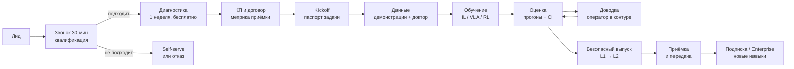

# 13. Путь клиента, ключевая ценность и коммерческое предложение

> Автор: Claude (координатор) · Дата: 2026-10-28 · Опирается на research/: 00, 05, 06, 07, 08, 10, 11, 12. Новых фактов нет: цены и сроки взяты из 06 §D и 12 §7 и остаются оценками; всё, что зависит от конкретного клиента, помечено `[УТОЧНИТЬ: …]`.

**Важная оговорка.** Продукта пока нет. Ниже — целевой процесс Фазы 1 (3–12 мес., см. 10 §6). До готовности MVP часть шагов команда делает вручную (concierge), а платформа берёт их на себя по мере готовности. Каждый пилот обязан превращаться в шаблон продукта, иначе компания становится консалтингом (06 §D, правило «услуги ≤30% выручки»).

---

## 1. Ключевая ценность продукта

**В одной фразе:** мы превращаем «робот иногда справляется» в «робот справляется в N% случаев — вот доказательство, ограничения и журнал».

Клиент платит не за GPU-часы и не за «обучение RL», а за **уверенность в результате**: измеренную надёжность навыка, понятные причины отказов и безопасный выпуск. Кнопка «обучить» уже бесплатна в open source (LeRobot, Isaac Lab, LeLab); дефицит — определить успех, доказать результат и выпустить без риска (см. 00 §1, 10 §1.5).

| Клиент | Его боль | Что получает | Чем заменяем |
|---|---|---|---|
| Малый интегратор (1–10 манипуляторов) | Задачи с вариативностью (разные детали, свет, положение) плохо ложатся на жёсткую программу; нечем доказать заказчику надёжность | Навык с измеренной успешностью, паспорт политики для заказчика, экспорт без привязки к нам | Часы ручного программирования и перенастройки; интеграция дороже робота в 4–5 раз (08) |
| Ранний робо-стартап | Нужен RL / robot learning, а такого инженера долго и дорого нанимать ($185–475 тыс./год в США, 05 §5) | Готовая «петля надёжности»: данные → дообучение → оценка → доводка → выпуск | Найм RL-команды и собственная инфраструктура оценки |
| Университетская лаборатория или курс | Студенты тратят семестр на инфраструктуру, а не на задачу; результаты не воспроизводятся | Рабочая политика за одно занятие, воспроизводимая оценка, материалы курса | Самописные пайплайны и разрозненные ноутбуки |
| Мейкер (канал, не касса) | Сложно начать | Первая политика за ≤60 минут | Недели на изучение стека |

**Три вещи, которых нет у бесплатных инструментов** (дифференциация, 09 §B.5):
1. **Измерение:** серии прогонов с доверительными интервалами, разбор отказов, сравнение версий — вместо «на видео сработало».
2. **Доводка на реальном железе:** коррекции оператора и RL-доводка с безопасным контуром, а не только имитация.
3. **Безопасный выпуск и доказательная база:** лестница автономии L0–L3, независимые ограничители, журнал версий, паспорт политики. В ЕС это становится нужнее: ПО — продукт со строгой ответственностью с 09.12.2026, ML-функции безопасности машин — через нотифицированный орган с 20.01.2027 (07, 09).

---

## 2. Три входа в продукт

| Вход | Для кого | Как платит | Роль в бизнесе |
|---|---|---|---|
| **Self-serve** | Мейкеры, студенты, исследователи, малые команды | Hobby $0 → Maker $19 → Pro $49 → Team $199/мес + кредиты | Воронка и данные о продукте |
| **Платный пилот** (основной путь Фазы 1) | Интеграторы, робо-стартапы, лаборатории с бюджетом | $15–40 тыс. фикс, 6–10 недель | Первые деньги, шаблоны, кейсы |
| **Образование** | Вузы, школы, курсы | $500–2 000 за курс, наборы роботов через партнёров | Ранняя выручка, канал |

После пилота клиент переходит на **Team** или **Enterprise ($30–150 тыс./год)**: непрерывное улучшение, новые навыки, мониторинг, аудит (06 §D.3).

---

## 3. Основной пайплайн: от первого контакта до выполненной услуги (платный пилот)

### Этап 0. Откуда приходит клиент
- Сообщество LeRobot, хакатоны, ролики «научили робота за час» (08 §C–D).
- Free/Pro-пользователи, у которых задача упёрлась в надёжность или лимиты (сигнал в продукте: много прогонов, низкая успешность).
- Партнёрский канал: интеграторы, продавцы железа (Seeed, UR, Unitree), позже ассистенты через MCP-сервер.
- Прямой выход на лаборатории и стартапы (список из 60 контактов в первые 90 дней, 10 §7).

### Этап 1. Квалификационный звонок (30 минут)
**Цель:** за полчаса понять, сможем ли мы реально помочь, и не брать «невозможные» задачи.

| Критерий «берём» | Критерий «не берём» (пока) |
|---|---|
| Робот поддерживаемого класса: SO-101, Franka, UR, xArm, Unitree или LeRobot-совместимый | «Любой навык на любом роботе» |
| Задача из поддерживаемых классов: pick-and-place, сортировка, укладка, вставка, локомоция по шаблону | Навык как функция безопасности машины (запрещено ToS, 07 §B) |
| Успех можно проверить: «деталь в лотке», «ящик открыт» | Работа в контакте с людьми, медицина |
| Есть доступ к роботу и человек со стороны клиента ~2–4 ч в неделю | Нет доступа к роботу или ограждённой зоны / e-stop |
| Есть владелец бюджета и понятная цена ошибки | «Посмотрим, что получится» без бюджета |

Не подошёл → предлагаем self-serve или честный отказ. Это экономит месяцы обеим сторонам.

### Этап 2. Бесплатная диагностика (1 неделя)
- Клиент присылает датасет в формате LeRobot или 10–20 минут видео задачи [УТОЧНИТЬ: минимальный объём после прототипа] и описание успеха.
- Мы прогоняем «доктор датасетов» и базовое обучение (baseline). Себестоимость для нас — $1–15 compute (05 §2.2) плюс время инженера.
- **Результат — «Отчёт о готовности»:** текущая успешность (если можно замерить), качество данных, главные риски, реалистичная цель, план и цена пилота.
- Если прирост маловероятен — говорим об этом прямо и пилот не продаём. Это и фильтр, и главный аргумент доверия для скептика.

### Этап 3. Коммерческое предложение и договор
- **Фиксированная цена и одна задача** — защита от расползания объёма.
- **Метрика приёмки в договоре:** доля успешных выполнений на N испытаниях (по умолчанию 50 на условие, 10 §6) в оговорённых условиях (положения объектов, освещение), с доверительным интервалом.
- **Оплата:** 50% на старте, 50% после приёмки. **Стоп-кран:** если к 4-й неделе метрика не растёт относительно базовой, клиент может остановить пилот после первого платежа.
- **Данные и права:** данные и обученная политика принадлежат клиенту; мы используем только метаданные запусков для улучшения платформы; использование данных для обучения наших моделей — только opt-in (10 §4.3, 07 §D).
- **Безопасность и ответственность:** выпуск только до уровня L2 (ограждённая зона); политика не используется как функция безопасности; ответственность за безопасность ячейки — на клиенте; лимит ответственности и NDA (07 §B, 12 §1.6).

### Этап 4. Kickoff (неделя 0–1)
Через чат-агента составляем три документа:
1. **Паспорт задачи:** цель, критерий успеха, примеры успеха и провала, ограничения (зоны, скорость, сила).
2. **Профиль робота:** кинематика, камеры, пространство действий, контроллер.
3. **Протокол приёмки:** сценарии, число испытаний, варьирование условий.

Клиент подтверждает все три — это защищает обе стороны при приёмке.

### Этап 5. Данные (недели 1–2)
- Запись демонстраций телеоперацией (leader-follower, геймпад, VR): на простой навык 2–5 часов оператора (05 §4).
- «Доктор датасетов» в реальном времени: брак эпизодов, нехватка вариативности, плохие ракурсы, советы «что записать ещё».
- Версионирование датасета: всегда понятно, на чём обучена каждая версия.

### Этап 6. Обучение (недели 2–4)
- Платформа выбирает метод сама: имитация (ACT, Diffusion Policy) → дообучение VLA (SmolVLA, π0.5) → RL в симуляции, если задача это позволяет (локомоция).
- Награда и критерий успеха строятся из примеров «успех / провал» и описания словами; проверка на «обман награды» (reward hacking) обязательна (02 §6, 07 §D).
- Бюджет и потолок расходов на compute фиксируются заранее: типичная задача стоит нам $1–130 (05 §2.2).

### Этап 7. Оценка (недели 3–5)
- Серии прогонов: в симуляции и на реальном роботе.
- Отчёт: доля успеха с доверительным интервалом, видео каждой попытки, **таксономия отказов** («не дотягивается», «теряет хват при бликах»), сравнение версий.

### Этап 8. Доводка (недели 4–7) — «петля надёжности»
- Робот работает в режиме L1: сниженные лимиты, оператор у e-stop.
- Оператор исправляет ошибки, платформа дообучает политику на коррекциях и автономном опыте (HIL-RL / residual RL, по образцу HIL-SERL и π*0.6, 02 §3).
- После каждой итерации — повторная оценка (Этап 7).
- Цель Фазы 0 для гипотезы: +10–15 п.п. успешности к базовой имитации (10 §6). Это гипотеза, а не гарантия; её проверяем первыми экспериментами.

### Этап 9. Безопасный выпуск (недели 6–8)
- Лестница автономии: L0 (симуляция) → L1 (сниженные лимиты, оператор) → L2 (полные лимиты в ограждённой зоне). L3 (рядом с людьми) — вне пилота (10 §4.2).
- Политика только предлагает действие; независимый детерминированный слой ограничений (скорость, сила, зоны, e-stop) решает (07 §A).
- Экспорт (LeRobot / ONNX) и локальный агент развёртывания на ПК клиента или Jetson; поэтапный (canary) выпуск, откат к прошлой версии.
- **Паспорт политики:** данные, версия, область применимости, результаты проверок, лимиты. Это документ для интегратора и его заказчика, а не сертификат.

### Этап 10. Приёмка и передача (недели 8–10)
- Приёмочные испытания по протоколу из Этапа 4.
- Клиент получает: политику, версию датасета, отчёт оценки, паспорт политики, профиль безопасности, экспорт кода (escape hatch — без привязки к нам).
- Две обучающие сессии для команды клиента.
- Ретроспектива; с разрешения — анонимный кейс.

### Этап 11. После пилота — расширение
- **Team ($199/мес)** или **Enterprise ($30–150 тыс./год):** новые навыки, мониторинг, непрерывное улучшение на логах эксплуатации, аудит, SSO/VPC.
- Расширение: те же навыки на другие ячейки, новые задачи, новые роботы.
- Внутри нас: решение из пилота становится **шаблоном продукта** — следующий похожий клиент проходит быстрее и дешевле.

---

## 4. Кто что делает (RACI-упрощённо)

| Этап | Клиент | Мы | Платформа |
|---|---|---|---|
| Квалификация, диагностика | Описание задачи, данные/видео | Звонок, отчёт о готовности | Доктор датасетов, baseline |
| Kickoff | Подтверждает паспорт, профиль, протокол | Ведёт сессию | Чат-агент формирует документы |
| Данные | Оператор: 2–5 ч демонстраций | Инструкции, контроль качества | Запись, версии, доктор |
| Обучение и оценка | Доступ к роботу для прогонов | Выбор и настройка, разбор отказов | Обучение, серии прогонов, отчёт |
| Доводка | Оператор у e-stop | Ведёт итерации | HIL-RL, переоценка |
| Выпуск и приёмка | Безопасность ячейки, приёмка | Паспорт, обучение команды | Ограничители, экспорт, журнал |

**Наша команда на пилот (оценка):** solutions-инженер с опытом robot learning ~0,5 FTE на 6–10 недель + поддержка платформы. До MVP почти всё делает инженер вручную.

---

## 5. Коммерческое предложение: пакеты

Все цены — оценки из 06 §D и 12 §7, подлежат проверке ценовыми тестами в Фазе 0 (10 §7).

| Пакет | Цена | Срок | Что входит |
|---|---|---|---|
| **Диагностика** | $0 | 1 неделя | Отчёт о готовности: baseline, качество данных, риски, план пилота |
| **Пилот «Старт»** | $15 тыс. | 6 недель | 1 задача, удалённо; имитация / дообучение VLA, оценка с CI, безопасный экспорт; демонстрации записывает клиент по нашей инструкции |
| **Пилот «Надёжность»** (рекомендуемый) | $25 тыс. | 8 недель | «Старт» + доводка с оператором в контуре на реальном роботе, таксономия отказов, паспорт политики |
| **Пилот «Ячейка»** | $40 тыс. | 10 недель | До 2 задач или одна контактно-сложная; интеграция с ROS 2 / контроллером; выезд [УТОЧНИТЬ: география и командировочные] |
| **После пилота** | Team $199/мес или Enterprise $30–150 тыс./год | Подписка | Новые навыки, мониторинг, улучшение на логах, аудит, SSO/VPC |
| **Образование** | $500–2 000 за курс | Семестр | Лицензии на класс, материалы, наборы роботов через партнёров |

**Условия для всех пилотов:** фиксированная цена; 50% на старте и 50% после приёмки; стоп-кран на 4-й неделе; данные и политика — клиента; экспорт без привязки к нам.

**Рекомендация для первых трёх клиентов (design-партнёры):** скидка [УТОЧНИТЬ: 30–50% — решение основателя] в обмен на еженедельную обратную связь, право на анонимный кейс и согласие на интервью. Без кейсов полная цена продаётся тяжело, а фидбек сейчас ценнее денег.

**Экономика пилота для нас (оценка).** 0,5 FTE × 2 месяца × ~$15 тыс./мес полной стоимости (05 §7.2) ≈ $15 тыс. людей + compute $1–3 тыс. Значит, пилот за $15 тыс. — около нуля маржи и оправдан только как вход; $25–40 тыс. дают маржу. Реальный RL на месте у клиента дешевле $25 тыс. не продавать.

---

## 6. Письмо-КП (по формату скилла КП)

Цель письма — получить 30-минутную встречу, а не продать пилот сразу. Читатель — руководитель интегратора или технический директор робо-стартапа: прагматик, к «обучению роботов ИИ» относится скептически.

> **Тема:** Надёжность [задача] на ваших роботах — с измеримым итогом
>
> [Имя], задачи вроде [УТОЧНИТЬ: задача клиента, например укладка разнородных деталей] плохо ложатся на жёсткую программу: детали лежат по-разному, меняется свет, и робот «иногда справляется». Каждая перенастройка съедает часы, а показать заказчику, насколько система надёжна, нечем.
>
> Что предлагаем:
> 1. **Диагностика за неделю, бесплатно.** Вы присылаете записи демонстраций или видео задачи, мы возвращаем отчёт: текущая успешность, качество данных, риски и реалистичный план. Вы получаете оценку до любых затрат.
> 2. **Пилот на одной задаче.** Дообучаем открытые модели на ваших данных и доводим навык с оператором в контуре. Вы получаете долю успешных выполнений на серии испытаний, видео каждой попытки и разбор отказов.
> 3. **Безопасный выпуск.** Навык работает под независимыми ограничителями скорости и силы, с журналом версий и откатом. Вы получаете паспорт политики для заказчика и экспорт без привязки к нам.
>
> Сроки и этапы:
> Неделя 1 — диагностика и согласование метрики приёмки.
> Недели 2–7 — данные, обучение, оценка, доводка.
> Недели 8–10 — выпуск, приёмка, обучение вашей команды.
>
> Цена: фиксированная, $15–40 тыс. в зависимости от сложности задачи; 50% на старте, 50% после приёмки. Если к 4-й неделе метрика не растёт относительно исходной, вы можете остановить пилот после первого платежа.
>
> Предлагаю созвониться на 30 минут [УТОЧНИТЬ: дата и время], выбрать одну задачу и договориться, как мерить успех.
>
> [Подпись]

**Самопроверка (по скиллу):** (1) первый абзац — про проблему клиента, о себе ни слова ✓; (2) выдуманных цифр нет: сроки и цена — наши условия из 06 §D, всё про клиента — `[УТОЧНИТЬ]` ✓; (3) следующий шаг один — звонок с датой ✓; без восклицательных знаков и клише ✓; ~230 слов ✓.

**Первый абзац для других сегментов** (остальное письмо то же, с поправкой цены и пакета):
- *Робо-стартап:* «[Имя], у [продукт] навык [задача] работает в демо, но [УТОЧНИТЬ: доля неудач / что ломается] в реальных условиях. Нанимать под это RL-команду долго, а без инфраструктуры оценки непонятно, стала ли новая версия лучше.»
- *Лаборатория / курс:* «[Имя], студенты курса [название] тратят большую часть семестра на настройку обучения и симуляции, а результаты сложно воспроизвести и сравнить между группами.» → пакет «Образование» $500–2 000 за курс.

---

## 7. Риски пайплайна и что с ними делаем

| Риск | Где проявится | Что делаем |
|---|---|---|
| Задача не подходит для обучения | Этапы 1–2 | Фильтр на звонке и диагностике; честный отказ |
| Плохие данные | Этап 5 | Доктор датасетов, инструкции оператору |
| Нет прироста от RL | Этап 8 | Стоп-кран на 4-й неделе; сужение до имитации + оценки |
| «Обман награды» | Этапы 6–8 | Тесты наград, аудит видео перед выпуском |
| Расползание объёма | Весь пилот | Одна задача, фиксированная цена, протокол приёмки |
| Инцидент на реальном роботе | Этапы 8–9 | Только L1–L2, независимые ограничители, e-stop, ToS, страховка |
| Превращение в консалтинг | После пилота | Каждый пилот → шаблон продукта; услуги ≤30% выручки |

## 8. Метрики воронки (цели Фазы 1, 10 §6)

- Звонок → диагностика → пилот → подписка: конверсии [УТОЧНИТЬ: замерить на первых 20 лидах].
- Время первой политики ≤60 минут; активация ≥25%.
- ≥3 клиента переходят на годовой контракт к 12-му месяцу; ≥1 клиент выпустил политику без нашего участия.
- Цикл сделки: лаборатории и стартапы — недели; интеграторы — 6–18 месяцев (08 §B). Поэтому первые деньги — от лабораторий и стартапов.

## Выводы для платформы

1. Продаём **уверенность в результате** — измеренную надёжность и безопасный выпуск, — а не GPU-часы и не «RL».
2. Главный путь Фазы 1 — **платный пилот на одной задаче** с фиксированной ценой, метрикой приёмки и стоп-краном.
3. **Бесплатная диагностика** — одновременно фильтр, инструмент продаж и доказательство честности для скептиков.
4. Пилоты дешевле $25 тыс. с выездом и реальным RL — около нуля маржи; брать их только как вход для design-партнёров.
5. Каждый пилот обязан стать шаблоном продукта, иначе компания превращается в консалтинг.
6. После пилота — переход на Team или Enterprise; это и есть бизнес, пилот — только вход.

## Источники

Новых внешних источников нет. Все фактические утверждения и цены взяты из файлов research/ (ссылки на разделы указаны в тексте; полные списки источников с URL — в каждом файле): 02 (методы обучения), 05 (себестоимость, команда), 06 (тарифы и пилоты), 07 (безопасность, регуляторика, ToS), 08 (сегменты, циклы продаж), 09 (конкуренты), 10 (фазы, ворота, 90 дней), 12 (финансы).
